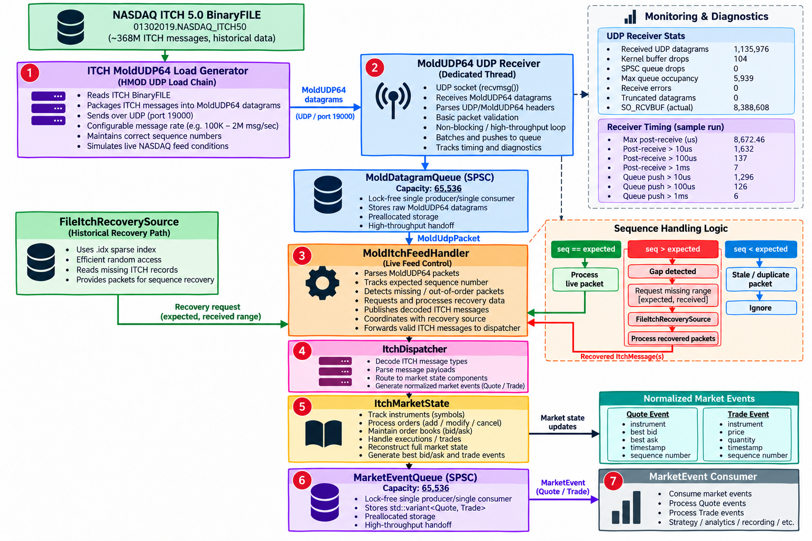

NASDAQ REAL-TIME MARKET-DATA INFRASTRUCTURE ARCHITECTURE
========================================================



### Lock-Free SPSC Throughput

The SPSC benchmark transports pre-created `MarketEvent` objects between
one producer and one consumer thread using a 4,096-slot preallocated queue.
The workload contains an even 50/50 mix of `Quote` and `Trade` events.


|     Events |    Quotes |    Trades | Runs | Median Time |    Median Throughput |
| ---------: | --------: | --------: | ---: | ----------: | -------------------: |
| 10,000,000 | 5,000,000 | 5,000,000 |    5 |     0.392 s | **25.5M events/sec** |

Measured using a Release build. Event construction is performed before
the timed section.

# Performance Benchmarks

The market-data engine is benchmarked at multiple boundaries rather than
reporting a single throughput number.

This distinction matters because decoding an ITCH message is substantially
different from processing that message through market state, maintaining order
books, generating normalized market events, transferring those events between
threads, and finally consuming them.

The current benchmarks therefore measure three increasingly complete paths:

```text
1. Decode Benchmark

BinaryFILE
    ↓
ITCH Decoder


2. Core Market-Data Benchmark

BinaryFILE
    ↓
ItchStreamReader
    ↓
ITCH Decoder
    ↓
MarketState
    ├── instruments
    ├── orders
    └── books


3. Full End-to-End Pipeline Benchmark

BinaryFILE
    ↓
ItchStreamReader
    ↓
ITCH Decoder
    ↓
MarketState
    ↓
Quote / Trade normalization
    ↓
SPSC MarketEventQueue
    ↓
Consumer thread
```

All benchmarks below use the Nasdaq TotalView-ITCH 5.0 dataset:

```text
data/itch/01302019.NASDAQ_ITCH50
```

The dataset contains more than 368 million ITCH messages and provides a
large-scale workload for exercising the market-data engine.

## Dataset

```text
File                  : 01302019.NASDAQ_ITCH50
Records read          : 368,366,634
Decoded messages      : 368,366,634
Unsupported messages  : 0
Malformed messages    : 0

Instruments           : 8,713
Books                 : 8,695
Peak active orders    : 1,742,866
```

Every message encountered in the dataset is recognized by the current decoder:

```text
368,366,634 decoded
0 unsupported
0 malformed
```

The replay currently reports:

```text
Replay status : INCOMPLETE
```

because the BinaryFILE reader distinguishes physical EOF from an explicit
zero-length framing record.

The Nasdaq file reaches its final ITCH System Event message before physical EOF,
so this status reflects the reader's current EOF semantics rather than an
unsupported or malformed ITCH message.

---

# ITCH Decode Benchmark

The decode benchmark measures the narrowest part of the system:

```text
ITCH BinaryFILE
      ↓
Binary framing
      ↓
ITCH message decoding
```

It does not maintain orders or order books and does not publish normalized
market events.

A representative Release-build result:

```text
Records              : 368,366,634
Decoded              : 368,366,634
Unsupported          : 0
Malformed            : 0

Elapsed              : 29.614 sec
Throughput           : 12.439 M messages/sec
```

### Decode Throughput

**~12.44 million ITCH messages/sec**

This benchmark primarily measures binary framing and protocol decoding and
therefore represents the upper-throughput boundary of the current pipeline.

---

# Core Market-Data Pipeline Benchmark

The core benchmark extends the decoder into stateful market-data processing:

```text
ITCH BinaryFILE
      ↓
ItchStreamReader
      ↓
ITCH Decoder
      ↓
MarketState
      ├── InstrumentStore
      ├── OrderStore
      └── BookStore
             ↓
          OrderBook
          ├── bids
          └── asks
```

This path processes the complete dataset while maintaining the live market
state represented by the ITCH feed.

A representative optimized Release-build run:

```text
Records read          : 368,366,634
Decoded messages      : 368,366,634
Unsupported messages  : 0
Malformed messages    : 0

Elapsed               : 88.53 sec
Throughput            : 4.160 M messages/sec

Instruments           : 8,713
Peak active orders    : 1,742,866
Active orders at end  : 0
Books                 : 8,695
```

### Core Pipeline Throughput

**~4.16 million ITCH messages/sec**

Unlike the decode-only benchmark, this includes stateful order processing and
order-book maintenance.

---

# Core Pipeline Optimization

Performance work on the core pipeline was measurement-driven rather than based
on isolated micro-optimizations.

Profiling showed that the majority of execution time was spent inside market
state processing, with order lookup and book maintenance forming important hot
paths.

## Direct Order-Book Level Handles

Orders originally required price-based book-level lookup during removal and
modification.

The order representation was changed so that each stored order retains a handle
to its corresponding price level:

```cpp
struct StoredOrder
{
    Order order;
    BookSide::LevelHandle level;
};
```

This allows execution, cancellation, deletion, and replacement paths to operate
directly on the appropriate price level rather than repeatedly searching for it.

Representative performance improved from approximately:

```text
~2.2 M messages/sec
```

to approximately:

```text
~2.6 - 2.8 M messages/sec
```

depending on the run.

## Reusable ITCH Stream Buffer

The BinaryFILE reader originally allocated a new message buffer for every
record.

`ItchStreamReader` was changed to own and reuse its internal buffer, returning a
non-owning pointer and length for the current record.

This removed hundreds of millions of unnecessary per-record buffer
allocations/copies from the replay path.

Representative core throughput after this optimization reached approximately:

```text
~2.8 M messages/sec
```

## Flat Open-Addressed OrderStore

Profiling then identified the order store as one of the largest remaining
hotspots.

The original implementation used:

```cpp
std::unordered_map<OrderId, StoredOrder>
```

The dataset reaches a measured peak of:

```text
1,742,866 simultaneously active orders
```

The node-based hash table was replaced with a fixed-capacity, open-addressed
table using linear probing and backward-shift deletion.

The current table contains:

```text
4,194,304 slots
```

giving approximately:

```text
41.6% peak occupancy
```

for the measured dataset.

The table is allocated once on the heap and performs no per-order node
allocation during normal operation.

A subsequent full validation run produced:

```text
Elapsed               : 88.53 sec
Throughput            : 4.160 M messages/sec
```

Profiling after the change also removed the previous `std::__hash_table`
hotspot from the dominant execution path.

---

# End-to-End Market-Data Pipeline Benchmark

The full benchmark measures substantially more than decoding or market-state
maintenance.

It exercises:

```text
ITCH BinaryFILE
      ↓
ItchStreamReader
      ↓
ITCH Decoder
      ↓
MarketState
      ├── instrument state
      ├── order state
      └── order books
      ↓
Quote / Trade normalization
      ↓
SPSC MarketEventQueue
      ↓
Consumer thread
```

The measured elapsed time therefore includes:

- BinaryFILE framing
- ITCH binary decoding
- instrument-state maintenance
- order-state maintenance
- order-book mutation
- Quote generation
- Trade generation
- SPSC publication
- producer/consumer synchronization
- `MarketEvent` transport
- consumer-side event processing

This benchmark is the closest current measurement of the complete real-time
market-data processing path.

---

# SPSC Queue Optimization

The SPSC queue was optimized while preserving its fundamental design:

```text
single producer
single consumer
fixed capacity
no locks
no allocation during push/pop
acquire/release synchronization
```

## Cache-Line Separation

Producer and consumer indices were separated onto cache-line boundaries:

```cpp
alignas(64)
std::atomic<std::size_t> writeIndex_{0};

alignas(64)
std::atomic<std::size_t> readIndex_{0};
```

The goal is to prevent the producer and consumer from unnecessarily invalidating
the same cache line while independently advancing their positions.

## Cached Opposing Indices

The original implementation acquired the opposing thread's atomic index during
every push and pop.

The optimized implementation keeps thread-local cached copies:

```cpp
std::size_t cachedReadIndex_{0};
std::size_t cachedWriteIndex_{0};
```

The producer normally uses its cached view of the consumer's read position.

It refreshes the actual atomic `readIndex_` only when the cached value makes the
queue appear full.

Similarly, the consumer normally uses its cached producer position and refreshes
`writeIndex_` only when the queue appears empty.

This reduces cross-thread synchronization traffic while retaining
acquire/release ordering when producer/consumer communication is required.

## Heap-Backed Preallocated Storage

The queue originally stored all raw event slots directly inside the
`SpscRingBuffer` object.

Large queue capacities therefore increased the size of the queue object's stack
allocation.

The backing storage was changed to a single heap allocation performed when the
queue is constructed.

The queue still uses raw preallocated slots with placement construction and
explicit destruction:

```text
Queue construction
        ↓
one backing allocation
        ↓
preallocated raw slots

push()
  → placement construction
  → no heap allocation

pop()
  → move event
  → explicit destruction
  → no heap allocation
```

This keeps dynamic memory allocation outside the hot producer/consumer path
while allowing larger queue capacities without coupling queue size to thread
stack size.

---

# Queue Capacity and Backpressure Experiments

Once the SPSC synchronization path had been improved, queue capacity was tested
to determine whether the remaining event loss represented sustained consumer
underperformance or temporary burst/scheduling backpressure.


|  |  |  |  |  |  |
| - | -: | -: | -: | -: | -: |
|  |  |  |  |  |  |
|  |  |  |  |  |  |
|  |  |  |  |  |  |
|  |  |  |  |  |  |

# Lossless Full-Pipeline Benchmark

With the 65,536-slot SPSC configuration, the complete dataset was replayed
three consecutive times.

All three runs completed with:

```text
Dropped quotes        : 0
Dropped trades        : 0
Queue remaining       : 0
```

### Results


| Run        |       Elapsed | Decode Throughput | Published Events | Consumed Events | Dropped Events |
| ---------- | ------------: | ----------------: | ---------------: | --------------: | -------------: |
| 1          |     102.308 s |     3.601 M msg/s |      184,336,741 |     184,336,741 |          **0** |
| 2          |     101.312 s |     3.636 M msg/s |      184,336,741 |     184,336,741 |          **0** |
| 3          |      98.442 s |     3.742 M msg/s |      184,336,741 |     184,336,741 |          **0** |
| **Median** | **101.312 s** | **3.636 M msg/s** |  **184,336,741** | **184,336,741** |          **0** |

The normalized event counts were:

```text
Published quotes      : 174,754,676
Published trades      :   9,582,065
                       -----------
Published events      : 184,336,741

Consumed quotes       : 174,754,676
Consumed trades       :   9,582,065
                       -----------
Consumed events       : 184,336,741

Dropped quotes        : 0
Dropped trades        : 0
Queue remaining       : 0
```

The counts reconcile exactly:

```text
174,754,676 quotes
+ 9,582,065 trades
----------------------
184,336,741 published events

184,336,741 published
184,336,741 consumed
0 dropped
0 remaining
```

Across all three measured runs, every normalized event published by the
market-data engine was consumed by the downstream consumer.

---

# Backpressure Progression

The queue-capacity experiment produced the following progression:

```text
4,096 slots
    │
    └── 122,059 median dropped events
             ↓
16,384 slots
    │
    └── 5,467 median dropped events
             ↓
65,536 slots
    │
    ├── Run 1: 0 drops
    ├── Run 2: 0 drops
    └── Run 3: 0 drops
```

Or summarized:


| Queue Capacity | Usable Slots | Median Drops | Result                     |
| -------------: | -----------: | -----------: | -------------------------- |
|          4,096 |        4,095 |      122,059 | Loss under burst pressure  |
|         16,384 |       16,383 |        5,467 | Significant improvement    |
|         65,536 |       65,535 |        **0** | **Lossless across 3 runs** |

Increasing queue capacity from 4,096 to 16,384 reduced median measured drops by
approximately 95.5%.

The 65,536-slot configuration then completed three consecutive full-dataset
runs without dropping a normalized market event.

Because the smaller queues drained completely after replay and drop counts
varied significantly between otherwise identical runs, these measurements are
consistent with temporary producer/consumer burst or scheduling imbalance being
an important source of queue saturation.

The measurements do not, by themselves, prove a particular operating-system
scheduling mechanism.

# 

# Benchmark Summary


| Benchmark Boundary              | Input Messages | Representative Throughput | Normalized Event Loss |
| ------------------------------- | -------------: | ------------------------: | --------------------: |
| ITCH decode                     |    368,366,634 |        **12.439 M msg/s** |                   N/A |
| Core decode + market state      |    368,366,634 |        **4.160 M msg/s** |                   N/A |
| Full pipeline + SPSC + consumer |    368,366,634 |  **3.636 M msg/s median** |                 **0** |

These numbers intentionally measure different boundaries.

# Performance Evolution

The major measured stages of optimization were approximately:

```text
Initial stateful pipeline
        ~2.04 M msg/s
             │
             ▼
Direct book-level handles
        ~2.6 M msg/s
             │
             ▼
Reusable stream buffer
        ~2.8 M msg/s
             │
             ▼
Open-addressed OrderStore
        ~4.16 M msg/s
             │
             ▼
Full threaded pipeline
        ~3.64 M msg/s median
        0 normalized event drops
```

The final full-pipeline number is lower than the core number because it measures
a larger system boundary.

It additionally includes event normalization, SPSC transport, synchronization,
and consumer processing.

---

# Benchmark Methodology

Benchmarks are run using Release builds.

Example:

```bash
cmake -S . -B build-release -DCMAKE_BUILD_TYPE=Release

cmake --build build-release -j
```

Correctness is validated separately before performance measurements:

```bash
ctest --test-dir build-release --output-on-failure
```

Current suite:

```text
435 / 435 tests passing
```

The full pipeline benchmark can then be executed with:

```bash
./build-release/benchmarks/itch_pipeline_benchmark \
  data/itch/01302019.NASDAQ_ITCH50
```

Performance runs are repeated because local benchmark results can vary with:

- operating-system scheduling;
- CPU frequency and power state;
- thermal conditions;
- background processes;
- producer/consumer thread scheduling.

Repeated measurements and median values are therefore preferred over selecting
the fastest individual run.

---

# Current Performance Snapshot

```text
Nasdaq TotalView-ITCH 5.0 BinaryFILE
              │
              │ 368,366,634 messages
              ▼
       ItchStreamReader
              │
              ▼
          ITCH Decoder
              │
              │ ~12.44 M msg/s decode-only
              ▼
          MarketState
       ┌──────┼──────┐
       │      │      │
 Instruments Orders Books
              │
              │ ~4.16 M msg/s core pipeline
              ▼
     Quote / Trade Normalization
              │
              ▼
      SPSC MarketEventQueue
       65,536-slot capacity
       65,535 usable slots
              │
              ▼
        Consumer Thread
              │
       ┌──────┴─────────┐
       │                │
174,754,676 Quotes   9,582,065 Trades
       │                │
       └──────┬─────────┘
              │
              ▼
       184,336,741
       consumed events

Median full-pipeline throughput
       3.636 M input messages/sec

Dropped normalized events
       0

Queue remaining after replay
       0
```

The current results establish a lossless baseline for the existing:

```text
decode
  ↓
market state
  ↓
normalization
  ↓
SPSC distribution
  ↓
consumer
```

architecture.

Future performance work can therefore be evaluated against both throughput and
correctness rather than increasing throughput at the cost of silently dropping
downstream market events.

# Live MoldUDP64 Ingestion: Packet Loss, Recovery, and Receive-Path Analysis

The BinaryFILE benchmarks above measure offline replay. The following experiments measure a **different system boundary**: UDP delivery of MoldUDP64 datagrams into the live ITCH processing pipeline. Their throughput numbers are not directly interchangeable with the offline replay results.

## Live Receive Architecture

```text
MoldUDP64 UDP sender (macOS loopback)
              |
              v
      Kernel UDP socket buffer
              |
              v
 UdpMoldMarketDataSource::receive()
         (recvmsg)
              |
              v
     MoldUdpReceiver thread
              |
              v
  SPSC MoldDatagramQueue (65,536 slots)
              |
              v
      MoldItchFeedHandler
       |               |
       |               +--> sequence-gap detection
       |                     +--> disk-backed recovery source
       v
   ITCH decoding and market state
              |
              v
  SPSC MarketEventQueue (65,536 slots)
              |
              v
       Consumer thread
```

The dedicated receiver thread separates socket draining from ITCH parsing and downstream processing. Receiver-side counters track datagrams received, queued, queue-full drops, and maximum queue occupancy. The feed handler tracks live ITCH messages, detected sequence gaps, and recovered messages. The consumer tracks normalized event delivery.

The datagram queue reserves one slot to distinguish full from empty, so its 65,536 configured slots provide 65,535 usable positions.

## Workload and Measurement Boundary

A representative live experiment sends **50,000,000 ITCH messages over approximately 25 seconds**, targeting **2,000,000 ITCH messages/sec**. The workload contains approximately **1,136,080 MoldUDP64 datagrams**, or **45,443 datagrams/sec on average**, with roughly 44 ITCH messages per datagram.

The sender uses macOS loopback UDP. This is a useful repeatable software-path stress test, **not a physical-NIC or exchange-feed benchmark**. Reported kernel UDP counters are system-wide deltas; their exact agreement with receiver-side missing-datagram counts across multiple runs is strong evidence, but not per-socket instrumentation.

## Rate-Sensitivity Experiments


| Offered ITCH rate | Observed outcome                                         |
| ----------------- | -------------------------------------------------------- |
| 1.5M messages/sec | 3/3 runs without detected sequence gaps                  |
| 1.8M messages/sec | 2/3 runs without gaps; one run recorded 1,736 gap events |
| 2.0M messages/sec | Variable: both gap-free and gap/recovery runs observed   |

The results show that the conventional UDP implementation can handle the 2M messages/sec workload in some runs, but has not yet demonstrated consistent loss-free reception at that rate.

## Representative 2M Messages/sec Runs


| Metric                               | Gap-free run | Loss/recovery run | Latest instrumented run |
| ------------------------------------ | -----------: | ----------------: | ----------------------: |
| Expected UDP datagrams               |    1,136,080 |         1,136,080 |               1,136,080 |
| Received/queued datagrams            |    1,136,080 |         1,135,564 |               1,135,976 |
| Missing datagrams                    |            0 |               516 |                     104 |
| Kernel full-socket-buffer drop delta |            0 |               516 |                     104 |
| Detected ITCH sequence gaps          |            0 |               232 |                      20 |
| Recovered ITCH messages              |            0 |            24,154 |                   4,899 |
| Datagram queue-full drops            |            0 |                 0 |                       0 |
| Maximum datagram queue occupancy     |        2,761 |             9,219 |                   5,939 |

In the latest instrumented run:

```text
Live ITCH messages             49,995,101
Recovered ITCH messages             4,899
Total ITCH messages            50,000,000
Next expected sequence         50,000,001
Normalized events consumed     21,094,552
Normalized event drops                  0
Datagram queue remaining                0
```

The 104 missing datagrams matched the **+104** system-wide kernel UDP full-socket-buffer drop delta in that run. The SPSC datagram queue reported no overflow, and the consumer fully drained its published events.

**Interpretation:** The observed missing UDP datagrams are strongly associated with overflow in the conventional kernel UDP socket receive path, rather than overflow in the application's SPSC datagram queue. Recovery restored the missing ITCH sequence in these measured runs; this does **not** mean the network path itself was lossless.

## Current Findings

1. **The application-side queues are not the observed packet-loss point** in the reported live experiments: their queue-full drop counters remained zero and their queued work drained.
2. **Kernel UDP socket-buffer overflow is a demonstrated failure mechanism**: missing datagrams repeatedly matched the increase in full-socket-buffer drops.
3. **The failure is intermittent**, not a proven fixed throughput ceiling: at least one 2M messages/sec run completed without gaps or kernel buffer drops.
4. **Receiver scheduling is a plausible contributor**, but the existing wall-clock timing measurements do not isolate descheduling from CPU execution or other sources of delay.
5. **Sequence recovery is functioning in the measured cases**: live and recovered ITCH message counts reconciled to the expected 50 million messages.
6. **Kernel bypass is not yet proven necessary.** AF_XDP/DPDK remain candidate approaches to evaluate if a tuned conventional socket receiver cannot satisfy explicit loss and tail-latency requirements on the target Linux hardware.
